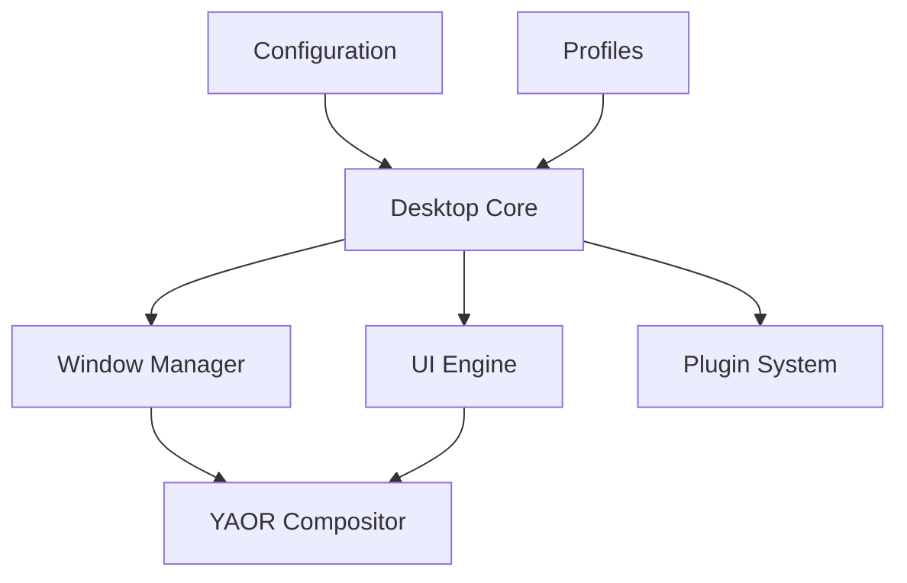

# Desktop Architecture



Le Desktop Core coordonne fenêtres, espaces de travail, panneaux, dock, launcher, thèmes, plugins, profils et configuration.

Les profils sont des configurations de l'expérience de bureau, pas trois systèmes indépendants.

```text
~/.config/yaor/
├── desktop.toml
├── theme.toml
├── windows.toml
├── keybindings.toml
├── panel.toml
├── launcher.toml
└── accessibility.toml
```
