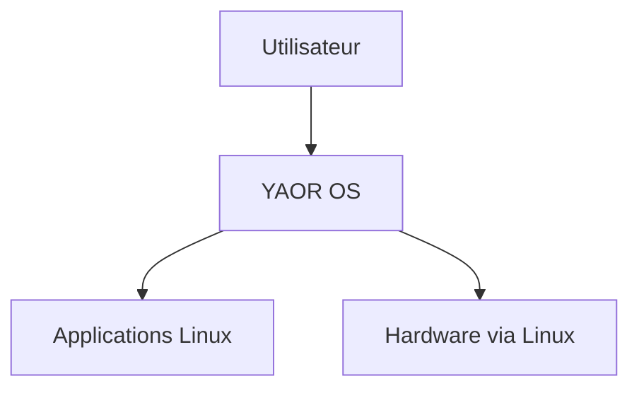
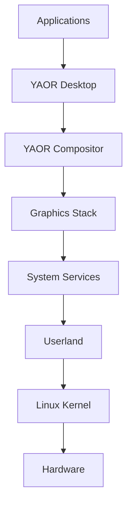

# System Overview — YAOR OS

## C4 — System Context

## C4 — Containers

## Principes
- Linux reste la fondation.
- Les composants existants sont réutilisés.
- Rust est privilégié lorsqu'une solution appropriée existe.
- YAOR développe les composants qui définissent son identité.
