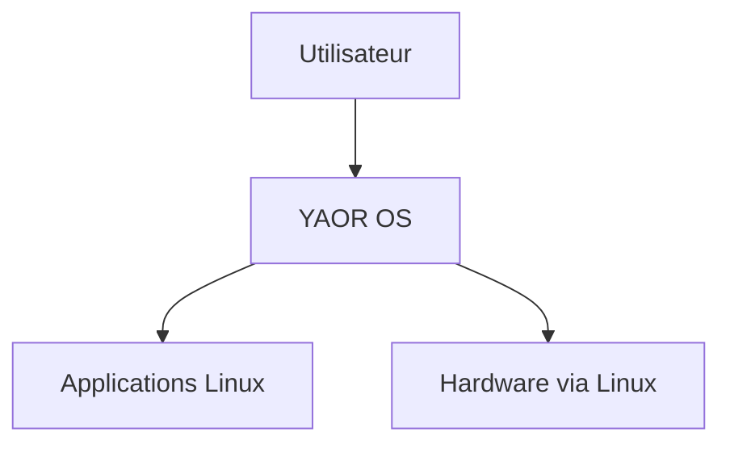
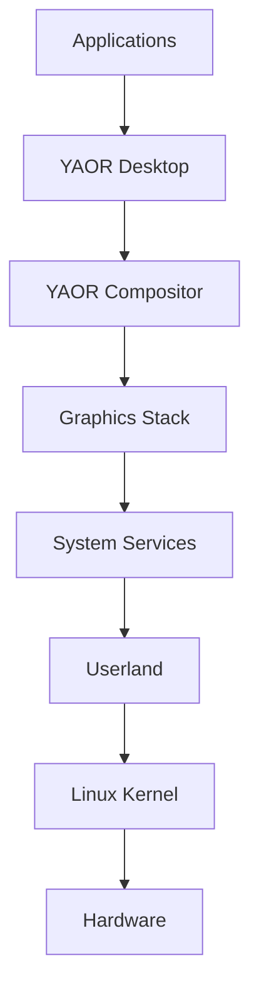
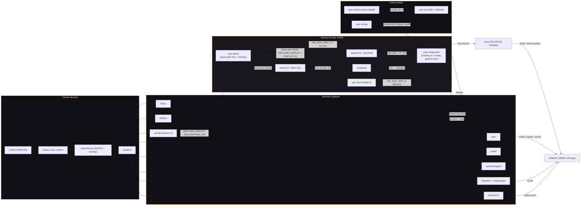

# System Overview — YAOR OS

## C4 — System Context

## C4 — Containers

## Principes
- Linux reste la fondation.
- Les composants existants sont réutilisés.
- Rust est privilégié lorsqu'une solution appropriée existe.
- YAOR développe les composants qui définissent son identité.

## Diagramme système as-built (v0.6 étape 1)

Composants réels de l'image live `yaor-live-x86_64-0.2.0.iso` et leurs
liaisons effectives (vérifiés en QA — `graphics-tests.md`). Les liens
en pointillés sont les livraisons à venir du jalon v0.6 « Caméléon ».

Principes de lecture :

- **un seul Desktop Core à venir** : `yaor-config` (+ profil) pilote
  la politique de fenêtrage du compositor — les profils sont des
  configurations, pas trois systèmes (`desktop-architecture.md`) ;
- le compositor est **maître DRM/KMS** (session via libseat/seatd) —
  les couches layer-shell (Top, Overlay) sont rendues au-dessus de
  l'espace de fenêtrage, leurs zones exclusives soustraites de la zone
  utile du tiling ;
- `yaor-panel` est le point d'entrée des apps YAOR internes (menu) :
  il les lance avec l'environnement hérité (Wayland ET X11).
