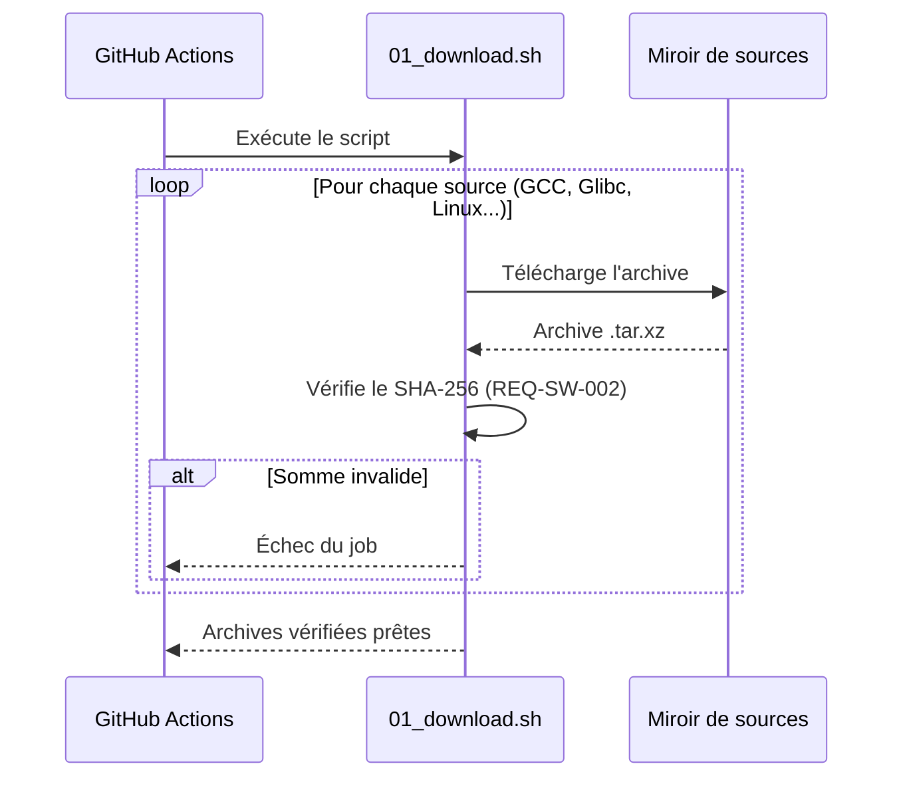
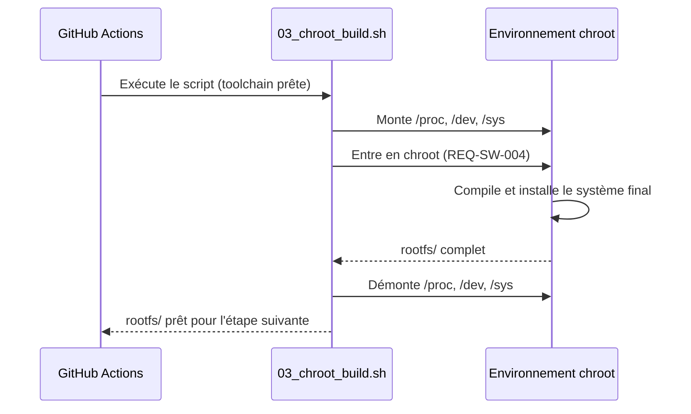
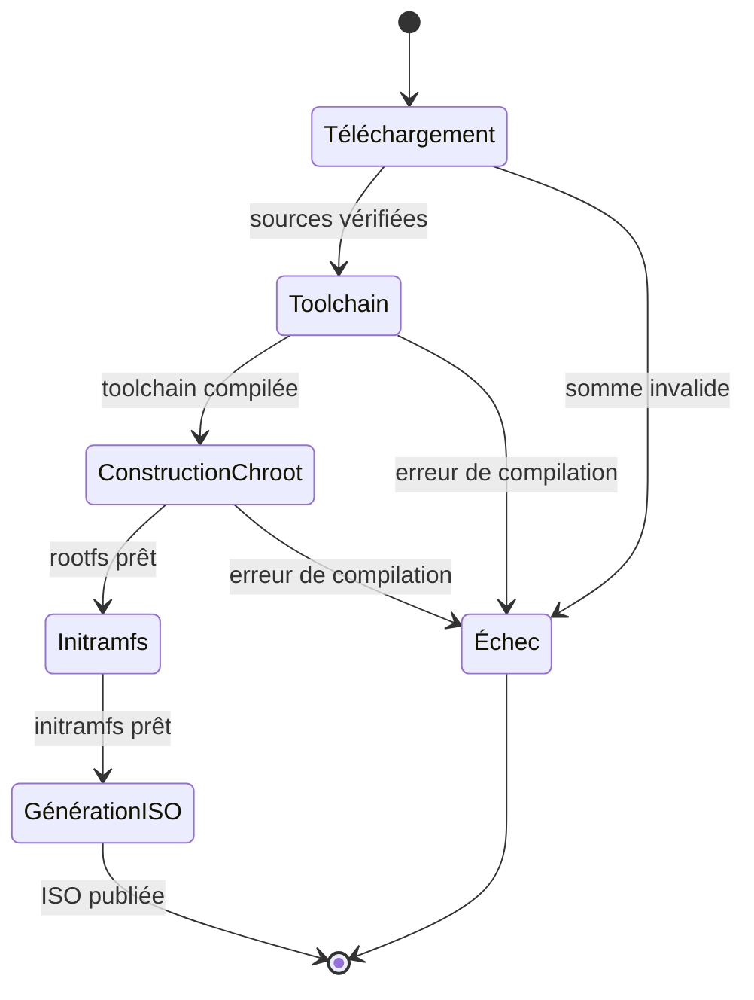
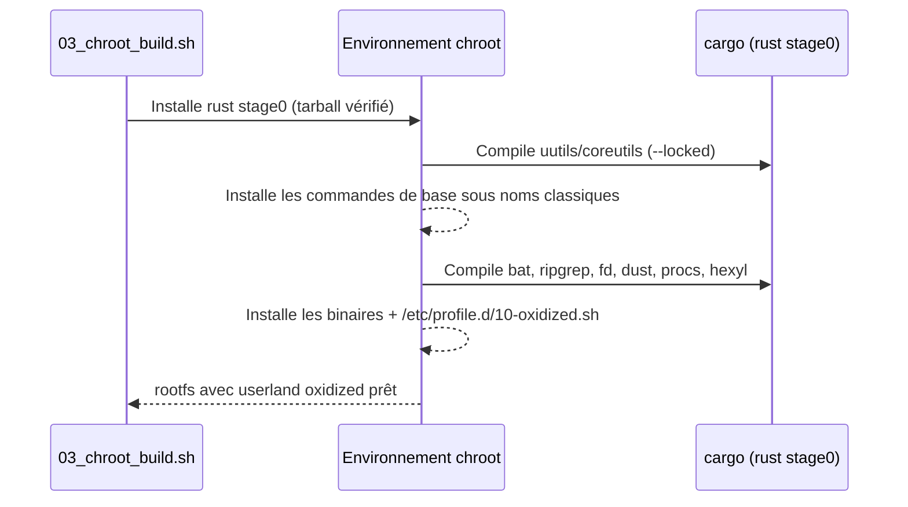

# Conception détaillée des composants (LLD) — yaor-os

**Statut :** Brouillon
**Version :** 0.2

## Séquence — `01_download.sh`

## Séquence — `03_chroot_build.sh`

## États — Cycle de vie d'un build

## Séquence — Installation du userland Rust (dans `03_chroot_build.sh`)

## Couche aliases — `/etc/profile.d/10-oxidized.sh`

Définis pour le shell interactif uniquement (RG-006) :

| Alias | Cible | Notes |
|---|---|---|
| `cat` | `bat` | pagination désactivée pour rester fidèle à `cat` |
| `grep` | `rg` (ripgrep) | options courantes compatibles |
| `find` | `fd` | syntaxe simplifiée, différence documentée dans GUIDE |
| `du` | `dust` | |
| `ps` | `procs` | |
| `hexdump` | `hexyl` | |

Contournement : préfixe `\outil` ou chemin absolu (RG-007). Le socle GNU minimal
(grep, findutils, sed, gawk, tar...) reste installé sous ses vrais noms pour les
scripts et comme repli.
